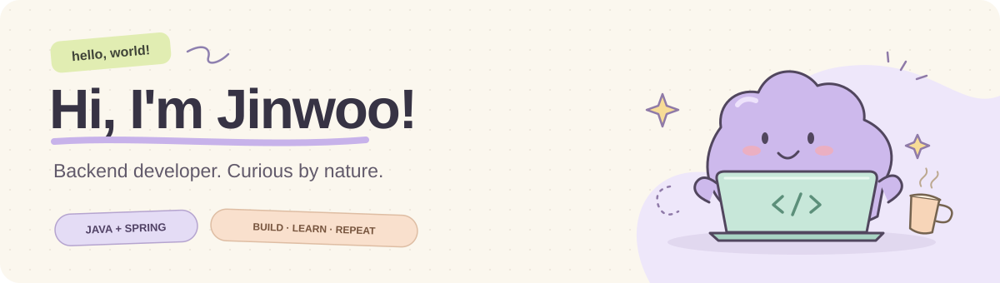

  

<h2 align="center">기술 선택의 이유를 설명하는 백엔드 개발자, 박진우입니다.</h2>

  Java와 Spring으로 서비스를 만들며, 동시 요청과 실패 상황에서의 동작을 고민합니다. 
  데이터 수집과 AI 추천에서 시작해, 거래 정합성과 실시간 이벤트 처리로 경험을 넓혀가고 있습니다.

  <a href="#projects">Projects</a> &nbsp;·&nbsp;
  <a href="#tech-stack">Tech Stack</a>

 

## Projects

### 01 &nbsp; GRAB · 한정 수량 DROP 커머스

**정해진 시간에 판매를 시작하고, 재고 변화를 실시간으로 전달하는 서비스**

`Java` `Spring Boot` `PostgreSQL` `Redis` `SSE`

4인 팀 · **담당: DROP·WISH 도메인, 상태 전환 배치, SSE, 프론트엔드 개발·검증 환경**

- **동시에 실행되는 배치의 중복 처리 방지** — Spring Scheduler와 `FOR UPDATE SKIP LOCKED`를 활용해 DROP 판매 상태를 전환합니다.
- **재고 변경을 화면까지 연결** — SSE 구독과 재연결, 연결 종료 시 자원 정리를 다루고 상품 상세·WISH·GRAB 목록에 연동했습니다.
- **AI 활용 개발의 검증 체계 구성** — OpenAPI 기반 TypeScript 타입 생성, ESLint·Prettier, Playwright E2E 검증을 개발 흐름에 연결했습니다.

[Repository ↗](https://github.com/prgrms-aibe-devcourse/AIBE7_FinalProject_Team3) · [SSE 구현 PR ↗](https://github.com/prgrms-aibe-devcourse/AIBE7_FinalProject_Team3/pull/128) · [E2E 검증 환경 PR ↗](https://github.com/prgrms-aibe-devcourse/AIBE7_FinalProject_Team3/pull/68)

 

### 02 &nbsp; Knotty · AI 매칭 기반 재능 거래 플랫폼

**자연어로 필요한 재능을 찾고, 채팅에서 거래까지 이어지는 서비스**

`Java` `Spring Boot` `Spring AI` `pgvector` `PostgreSQL` `Redis`

3인 팀 · **담당: AI 매칭, 거래 동시성 제어, 인증·사용자 포트폴리오**

- **의미 검색과 실제 거래 조건 결합** — Spring AI와 pgvector로 유사한 게시글을 찾고, DB 원본 데이터로 조건을 확인하는 매칭 흐름을 구현했습니다.
- **중복 결제 방지** — 거래·지갑·요청글에 비관적 락과 DB 제약을 적용하고, 상태 전이를 검증했습니다.
- **외부 AI 호출과 거래 트랜잭션 분리** — 임베딩 처리를 `AFTER_COMMIT` 비동기 이벤트로 옮겨 외부 호출이 트랜잭션의 락을 오래 점유하지 않도록 개선했습니다.

[Repository ↗](https://github.com/wlsdn020416/Knotty)

 

### 03 &nbsp; Packing · 여행 성향 기반 국내 관광지 추천

**실제 관광지 데이터에 사용자 성향과 여행 조건을 더하는 서비스**

`Node.js` `Express` `Supabase` `Gemini` `TourAPI`

4인 팀 · **담당: 관광지 데이터 수집·가공, 성향 점수 산정, LLM 추천**

- **추천에 사용할 데이터부터 설계** — TourAPI 관광지 데이터를 수집·정규화하고, 서비스 키워드와 MBTI 16유형 적합도 점수로 가공했습니다.
- **실제 장소를 기준으로 일정 생성** — DB에 존재하는 관광지를 후보로 제공하고, AI 호출 실패 시 규칙 기반 대체 일정을 반환하도록 구성했습니다.

[Repository ↗](https://github.com/wlsdn020416/Packing)

 

## Tech Stack

  
  
  
  
  

| 영역 | 프로젝트에서 사용한 기술 |
| :--- | :--- |
| Backend | Java · Spring Boot · Spring Data JPA · Spring Security · Node.js · Express |
| Data & AI | PostgreSQL · Redis · Spring AI · pgvector · Gemini · Supabase |
| Frontend | React · TypeScript · JavaScript · Vite · TanStack Query |
| Testing & Workflow | JUnit · Testcontainers · Playwright · GitHub Actions · Docker · OpenAPI |
